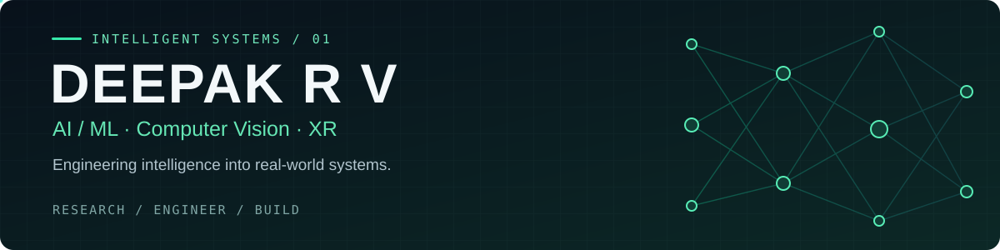

  
  <h3>Computer Vision & AI R&D · Software Engineering · Creative Technology</h3>
  
  
  

## About me

Computer Science and Engineering graduate specializing in Artificial Intelligence and Machine Learning, based in Chennai, India. I build and evaluate intelligent systems at the intersection of computer vision, software, hardware and interactive experiences.

- **Computer vision & applied R&D** — object detection, segmentation, tracking, camera calibration, geometric measurement and ground-truth validation.
- **XR & real-time systems** — Unity integration, device testing, performance profiling and experimental debugging.
- **Software engineering** — accessible mobile applications, automation pipelines, responsive frontend interfaces and interactive 3D web experiences.
- **Currently exploring** — LLMs, retrieval-augmented generation, LangGraph and AI agents.

## Technical stack

**Programming**

**AI / ML & computer vision**

**XR, mobile & web**

**Engineering & automation**

**Generative AI — learning & experimentation**

---

<b>Research. Engineer. Build.</b>

